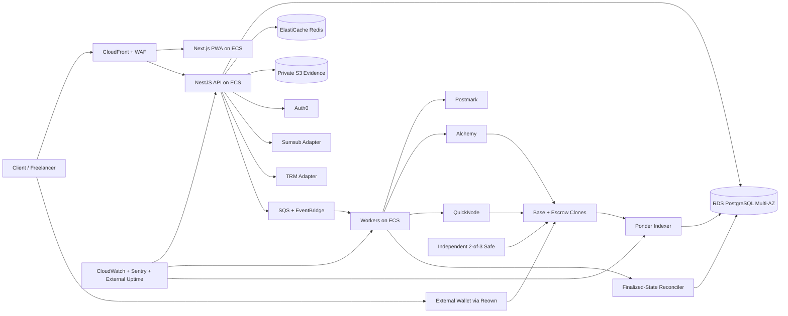

# EscrowAfrica MVP Technology Stack

Status: recommended production stack

Prepared: 21 August 2026

Source requirements: `ESCROWAFRICA_PRODUCT_AND_ARCHITECTURE_BLUEPRINT.md`

## Executive decision

Build EscrowAfrica as a TypeScript modular monolith on AWS, with an independently deployable chain indexer and worker processes. The customer-facing application is a mobile-first Next.js PWA. The API is NestJS on Fastify. PostgreSQL is the off-chain system of record, while Base contracts are the source of truth for escrow funds and settlement state.

Use Base mainnet and Circle-issued native USDC only. Each agreement receives an immutable, non-upgradeable EIP-1167 escrow clone. Customer wallets submit all value-moving transactions. EscrowAfrica never holds customer keys and has no server key capable of choosing payout recipients or amounts. Dispute awards require an independent 2-of-3 Safe.

For production, use Auth0 for application identity, Reown AppKit with wagmi and viem for external-wallet connection, Ponder plus an independent reconciler for chain indexing, private S3 for deliverables and evidence, Postmark for transactional email, and AWS ECS Fargate for application hosting.

This stack intentionally excludes embedded wallets, gas sponsorship, fiat custody, bank payouts, bridges, multiple chains, multiple stablecoins, and upgradeable customer-fund contracts from the MVP.

## Architecture rules that the stack must preserve

1. Base contract state, not the application database, determines ownership of escrowed funds.
2. PostgreSQL projections may be rebuilt from the factory deployment block.
3. A browser transaction hash is never accepted as proof of payment; the backend independently verifies the receipt, emitted event, block hash, sender, token, amount, contract, and canonicality.
4. UI amounts are formatted for people, but all calculations use USDC atomic units as integers. No binary floating point is allowed in money paths.
5. Files, names, email addresses, KYC identifiers, agreement text, and dispute evidence never go on-chain. Only canonical digests and state transitions do.
6. Production access, deployment authority, treasury authority, and arbitration authority are separate.
7. “NGN value” is an indicative display value, not a naira balance, quote, conversion promise, or payout entitlement.

## Selected stack at a glance

| Area | Production selection |
|---|---|
| Frontend | Next.js App Router, React, TypeScript, Tailwind CSS, Radix UI primitives, TanStack Query, React Hook Form + Zod, Serwist PWA |
| Backend | Node.js 24 LTS, NestJS with Fastify, REST/OpenAPI, Drizzle ORM, SQS workers, EventBridge Scheduler |
| Database | PostgreSQL 18 on Amazon RDS Multi-AZ; ElastiCache for Redis for ephemeral coordination only |
| Authentication | Auth0 Professional B2C with Universal Login; email OTP/passkeys; mandatory WebAuthn/TOTP MFA for privileged users; internal RBAC in PostgreSQL |
| Blockchain | Base mainnet, Base Sepolia outside production; Circle native USDC only; Alchemy primary RPC and QuickNode independent fallback |
| Smart contracts | Solidity, Foundry, OpenZeppelin Contracts 5.x, immutable EIP-1167 per-agreement clones, 2-of-3 Safe arbitration and separate treasury/deployment Safes |
| Wallet connection | Reown AppKit Pro, wagmi, viem; injected, mobile WalletConnect, Coinbase Wallet and Safe connectors; SIWE/EIP-4361 ownership proof |
| Blockchain indexing | Self-hosted Ponder on ECS using PostgreSQL, plus a separate NestJS/viem finalized-state reconciler |
| File storage | Private Amazon S3, SSE-KMS, versioning, presigned multipart upload, GuardDuty Malware Protection for S3, Object Lock for evidence/audit archives |
| Notifications | PostgreSQL notification center + transactional outbox, SQS Standard queues and DLQs, EventBridge Scheduler, idempotent delivery workers |
| Email | Postmark Pro transactional streams and signed webhooks; SPF, DKIM and DMARC |
| Monitoring | OpenTelemetry via AWS Distro for OpenTelemetry, CloudWatch logs/metrics/alarms, Sentry Team, external Better Stack uptime/status page |
| Analytics | PostHog Cloud EU for pseudonymous product analytics; financial/operational reporting remains in PostgreSQL/admin views |
| Testing | Vitest, Testing Library, Playwright, MSW, Supertest, Testcontainers; Foundry/Anvil, Forge fuzz/invariants, Slither and Echidna; ZAP, Semgrep, Trivy and Checkov |
| CI/CD | GitHub Team + GitHub Actions, pnpm workspaces, AWS OIDC, ECR, Cosign/Sigstore, Syft SBOM, Terraform, ECS blue/green promotion |
| Hosting | AWS Organizations; production in `eu-west-1`; CloudFront, WAF, ALB, private ECS Fargate, RDS Multi-AZ, ElastiCache, S3, SQS, EventBridge, ECR, Route 53 and ACM |
| Domain | `escrowafrica.com` as primary if controlled; `app`, `api`, `admin`, and `status` subdomains; defensive `.africa` and `.ng` registrations; Route 53 Domains/DNS + DNSSEC |
| Secrets | AWS Secrets Manager, KMS customer-managed keys, SSM Parameter Store for non-secret config, ECS IAM task roles, GitHub OIDC; KMS secp256k1 key for the permissionless relayer only |

Versions above name the intended major/runtime where a production decision is useful. Every dependency, compiler, base image, action, and Terraform provider must be pinned to a reviewed immutable version or digest in the repository. Upgrades require tests and security review; deployed contract bytecode never changes.

## 1. Frontend

**Selection:** Next.js App Router + React + TypeScript, Tailwind CSS, Radix UI primitives, TanStack Query, React Hook Form with Zod, and Serwist for a carefully limited PWA service worker.

1. **Why it is needed.** EscrowAfrica needs a fast, mobile-first interface for agreement drafting, KYC readiness, wallet signing, transaction tracking, milestone submission, disputes, and administration. Nigerian users on low-to-mid-range Android devices and intermittent networks need resumable forms and a small client bundle.
2. **Why selected.** Next.js provides routing, server rendering, streaming, metadata and a well-supported React deployment model. TypeScript is shared with the API and chain tooling. Radix supplies accessible behavior without forcing a visual system. TanStack Query handles server state and retry behavior; React Hook Form and Zod make long agreement forms explicit and testable. Serwist supports installability and static caching without turning private data into offline browser storage.
3. **Alternatives considered.** A Vite SPA is simpler but gives up useful server-rendering and route-level server behavior. Remix is strong for forms but has a smaller hiring and component ecosystem. Nuxt/Vue is capable but would introduce a second language ecosystem relative to wagmi and the Node backend. Vercel hosting was considered but rejected for production to keep network controls, logging, data location and incident response in one AWS estate.
4. **Cost implications.** All selected libraries are open source. Cost is the ECS/CloudFront hosting and engineering time. This avoids a separate per-seat or per-request frontend platform bill.
5. **Security implications.** Use HttpOnly, Secure, SameSite cookies; strict CSP with nonces; CSRF protection; output encoding; dependency scanning; no secrets or privileged RPC keys in browser bundles. The service worker caches only versioned static assets and an offline shell—never authenticated API responses, KYC pages, wallet messages, deliverables or evidence. Sensitive pages opt out of Sentry replay and analytics autocapture.
6. **Scalability implications.** Static assets and public pages cache at CloudFront. Stateful reads go to the API. Stateless Next.js containers scale horizontally on ECS. Server-only modules prevent sensitive integration code entering the client bundle.

## 2. Backend

**Selection:** Node.js 24 LTS, TypeScript, NestJS with the Fastify adapter, REST JSON under `/v1`, generated OpenAPI clients, Drizzle ORM over `node-postgres`, and independent API, worker and scheduler deployments from one modular-monolith codebase.

1. **Why it is needed.** The backend owns identity linkage, policy gating, agreement records, KYC readiness, signed envelope storage, upload authorization, notifications, disputes, audit records, chain transaction intents, indexing projections and reconciliation.
2. **Why selected.** NestJS makes module and authorization boundaries visible, while Fastify reduces HTTP overhead. TypeScript aligns the web, API, indexer and blockchain ABI types. REST/OpenAPI is operationally simpler than GraphQL for idempotent commands and regulated audit trails. Drizzle stays close to SQL and can represent `NUMERIC(78,0)` values as strings or JavaScript `bigint` without hiding database constraints.
3. **Alternatives considered.** Express is flexible but supplies less architectural discipline. Fastify alone is lighter but requires more project conventions. Go would improve raw efficiency but split the team/toolchain and slow product iteration. Prisma has excellent developer tooling, but its Decimal serialization and generated engine add avoidable money-type and deployment complexity here. Microservices were rejected until team boundaries or measured load justify them.
4. **Cost implications.** Frameworks are open source. Fargate is metered by requested CPU and memory. Separate worker tasks add modest compute cost but prevent email, malware, RPC or indexer latency from consuming API capacity.
5. **Security implications.** Global schema validation, explicit authorization guards, RFC 7807 errors, rate limiting, idempotency keys, optimistic concurrency, signed webhook verification, structured audit events and least-privilege AWS task roles are mandatory. The API prepares and simulates calldata but cannot sign customer value-moving transactions.
6. **Scalability implications.** Stateless API tasks scale behind the ALB. Slow work uses SQS with backpressure and DLQs. Domain modules can later be extracted without changing public contracts. Use the transactional outbox pattern so a committed state change cannot lose its asynchronous work.

## 3. Database

**Selection:** PostgreSQL 18 on Amazon RDS Multi-AZ with encrypted gp3 storage, point-in-time recovery and automated backups. Use ElastiCache for Redis as a Multi-AZ replication group only for rate limits, short locks, nonce replay prevention and cache—not balances, ledger data or canonical job state.

1. **Why it is needed.** Agreements, immutable submissions, provider results, audit history, idempotency records, chain events, projections, ratings and notification delivery require transactions, constraints and reliable relational joins.
2. **Why selected.** PostgreSQL provides strong transactions, check/unique constraints, JSONB where appropriate, mature backup/restore tooling and a clear path from MVP to large datasets. RDS Multi-AZ provides a standby in another Availability Zone and managed failover. One database also keeps the outbox and domain mutation atomic.
3. **Alternatives considered.** Aurora PostgreSQL scales further but adds cost and operational choices the MVP does not need. DynamoDB is excellent at key-value scale but makes relational integrity, investigations and ledger reconciliation harder. Supabase/Neon improve prototyping speed but weaken the single-cloud network and access-control model. MongoDB is a poor fit for money invariants and cross-entity constraints.
4. **Cost implications.** Multi-AZ roughly doubles instance and storage resources relative to Single-AZ. Budget roughly USD 180–450/month for the initial production RDS deployment depending on instance class, I/O, backups and region, plus roughly USD 50–150/month for a small highly available Redis replication group. Validate with the AWS calculator before procurement.
5. **Security implications.** Place both services in private subnets, require TLS, encrypt with KMS, rotate credentials, log privileged access, and separate application, migration, read-only reporting and break-glass roles. Application-layer envelope encryption protects especially sensitive case notes. Redis must have no public route and no authoritative financial data.
6. **Scalability implications.** Start with vertical scaling and correct indexes; add read replicas only for measured reporting pressure. Partition chain events, notifications and audit logs by time when required. Ponder uses its own PostgreSQL schema to avoid coupling migrations. PITR, restore drills and replay-from-chain satisfy the recovery model.

## 4. Authentication

**Selection:** Auth0 Professional B2C with separate development, staging and production tenants. Use Universal Login with email OTP and optional passkeys for customers. Require WebAuthn security keys or TOTP MFA for every admin, compliance user and arbitrator. Store application roles and authorization policy in PostgreSQL, not only in Auth0 metadata.

1. **Why it is needed.** Email identity, verified contact channels, secure sessions, recovery, MFA, step-up authentication and privileged-role protection are distinct from wallet ownership.
2. **Why selected.** Auth0 offers managed OIDC, passwordless email, passkeys, MFA, attack protection, tenant isolation, log streaming and mature Next.js/API integrations. The Professional tier is selected for production because this is a financial workflow and benefits from enhanced attack protection and stronger support/features; the free tier is acceptable only for development.
3. **Alternatives considered.** Amazon Cognito is cheaper and AWS-native but has rougher customization and operational ergonomics. Clerk is fast to integrate but less attractive for explicit OIDC portability and enterprise security controls. Privy/Dynamic combine identity and wallets but conflict with the MVP decision to keep email identity, KYC and external-wallet custody separable. Self-hosting authentication was rejected as unnecessary account-takeover risk.
4. **Cost implications.** Auth0's current self-service pricing lists Professional from USD 240/month for 500 MAU, while Essentials starts lower. Pricing rises with MAU and enterprise features. Budget the production plan from day one and seek startup credits only as a discount, not as an architectural dependency.
5. **Security implications.** Use Authorization Code + PKCE, short-lived tokens, rotating refresh tokens where needed, secure cookies, exact callback allowlists and Auth0 log streaming. Step-up is required before wallet replacement, evidence export and privileged actions. Auth0 authenticates a person/session; the API still authorizes every resource and records reason-coded actions.
6. **Scalability implications.** Managed CIAM removes password/session infrastructure from the application and supports substantially more users than the MVP. Keep a local immutable Auth0 subject mapping and a tested export/migration plan to control vendor lock-in.

### Wallet authentication boundary

Wallet linking uses SIWE/EIP-4361 after the Auth0 session is established. The challenge contains the exact production domain, URI, Base chain ID, random one-use nonce, issue time, five-minute expiry and session-bound request ID. Verify EOAs cryptographically and smart-contract wallets using EIP-1271. A verified wallet can provide step-up proof, but it does not silently replace the verified email account or KYC identity. Wallet changes trigger notification, cooldown and re-screening.

## 5. Blockchain

**Selection:** Base mainnet (`chainId 8453`) and Base Sepolia for non-production. Allowlist only Circle-issued native Base USDC at `0x833589fCD6eDb6E08f4c7C32D4f71b54bdA02913`. Use Alchemy Pay-As-You-Go as primary production RPC and QuickNode Build as an independently operated fallback.

1. **Why it is needed.** The chain provides publicly verifiable funding, deterministic milestone settlement and a non-custodial source of truth for locked value.
2. **Why selected.** Base is EVM-compatible, supports native issuer-backed USDC, has low fees, approximately two-second L2 blocks and a large wallet/tooling ecosystem. One chain and one exact token address sharply reduce wrong-asset, bridge and accounting risk. Alchemy and QuickNode both support Base archive/log APIs, but using both avoids a single provider deciding the application's view of the chain.
3. **Alternatives considered.** Ethereum L1 is too expensive for small freelancer milestones. Polygon, Arbitrum and Optimism are viable but add no MVP value once Base is chosen. Solana has low fees but would split smart-contract and wallet tooling. Multi-chain support and bridges multiply audit, liquidity, indexing and support risk. Public Base RPC endpoints are explicitly rate-limited and are not production infrastructure.
4. **Cost implications.** Users pay Base gas in ETH; gas is low but variable and includes L2 execution plus L1 data cost. Alchemy currently provides a free allowance and usage-based pricing around USD 0.40–0.45 per million compute units; QuickNode Build currently starts around USD 49/month before annual discount. Maintain a small, capped relayer gas budget only for permissionless timeout calls.
5. **Security implications.** Hard-code/immutably snapshot chain ID, token address and token decimals; reject bridged lookalikes and unknown tokens. Verify RPC responses against the fallback for critical blocks. Monitor USDC pause/blacklist events and disclose Circle issuer control. Never use preconfirmations as final settlement proof.
6. **Scalability implications.** Base capacity and low fees are well above expected MVP load. RPC usage scales horizontally and can move to higher provider tiers without protocol changes. Chain expansion remains a new product/audit project, not configuration.

### Exact confirmation policy

- `SUBMITTED`: wallet returned a hash; no business state changes.
- `INCLUDED`: successful receipt in a sealed L2 block; show progress but treat as reversible.
- `CONFIRMED`: event is at or below Base's `safe` head (normally L1 batch inclusion, roughly two minutes). Funding may now activate work and settlement notifications may be sent.
- `FINALIZED`: event is at or below Base's `finalized` head (normally roughly twenty minutes). UI may call it final.

Store block number and block hash at every stage. If a block becomes non-canonical, reverse only projections and derived notifications; never invent replacement financial state.

## 6. Smart contracts

**Selection:** Solidity compiled with one pinned audited compiler, Foundry for build/deployment/testing, OpenZeppelin Contracts 5.x, `EscrowFactoryV1`, non-upgradeable `MilestoneEscrowV1` EIP-1167 clones, SafeERC20, and existing Safe smart accounts for arbitration, treasury and deployment.

1. **Why it is needed.** Custom escrow state transitions are the core trust mechanism: exact full funding, sequential milestones, approval, timeout release, dispute freeze, split award and mutual cancellation.
2. **Why selected.** Solidity/Foundry has the deepest EVM testing and audit ecosystem. OpenZeppelin supplies reviewed token-transfer and security primitives. Per-agreement clones isolate balances, lower deployment cost and simplify investigation. Immutable implementations eliminate proxy-admin risk to funds. Safe provides established multisignature control without a custom multisig.
3. **Alternatives considered.** A single pooled contract is cheaper to deploy but increases blast radius and accounting complexity. Upgradeable proxies ease changes but create an unacceptable path for an admin key to alter live fund rules. CREATE2 full contracts cost more than clones without a proportional safety benefit. A custom multisig or DAO jury was rejected. Hardhat is capable, but Foundry is better suited to fast fuzzing, invariants and fork tests.
4. **Cost implications.** Open-source tools are free; deployment and calls consume Base gas. The material costs are an independent audit, retest and bug bounty. Budget approximately USD 40,000–150,000 for an experienced audit depending on final code size and auditor, separate from web/API penetration testing. Run a capped invite pilot even after audit.
5. **Security implications.** The implementation must be small, checks-effects-interactions compliant and free of arbitrary calls. Snapshot fee, treasury, arbitrator, parties, token and terms hash at creation. Factory administration may stop new creations but cannot redirect or block legitimate exits from existing escrows. Deployment, treasury and arbitration Safes use different hardware-backed signers. Publish verified source and reproducible bytecode.
6. **Scalability implications.** Clones are inexpensive, independent and discoverable from the factory. New behavior ships as `V2` for new agreements; old agreements finish under `V1`. Event schemas are versioned. Storage and milestone loops are capped at ten so gas cannot grow without bound.

Mandatory contract assurance includes Forge unit/fuzz/invariant tests, Echidna campaigns, Slither static analysis, pinned Base fork tests, manual threat modeling, independent audit, retest, signer ceremony and a public responsible-disclosure program.

## 7. Wallet connection

**Selection:** Reown AppKit Pro with the wagmi adapter and viem. Enable injected/EIP-6963 wallets, mobile WalletConnect deep links/QR, Coinbase Wallet and Safe. Disable embedded wallets, swaps, onramps, multichain browsing and gas abstraction for MVP.

1. **Why it is needed.** Nigerian freelancers and international clients will use different browser and mobile wallets. The application must reliably connect, switch to Base, sign SIWE/EIP-712 messages, simulate transactions and submit contract calls.
2. **Why selected.** AppKit handles mobile deep-link and QR edge cases across a broad wallet set. wagmi provides React state/hooks, while viem provides strongly typed ABI encoding, simulation, receipt checks and server-side EVM utilities. The paid Pro plan avoids a production cutoff at the free limit and supplies team access/support.
3. **Alternatives considered.** RainbowKit is excellent and remains the fallback if AppKit licensing or UX changes, but AppKit gives a supported production connection layer and mobile coverage in one choice. Privy/Dynamic add embedded identity/custody features outside MVP scope. Direct MetaMask/Coinbase integrations would omit many mobile wallets and create maintenance work. ethers.js is mature but viem provides stronger TypeScript-first primitives and integrates directly with wagmi.
4. **Cost implications.** Reown currently lists Pro at USD 89/month or USD 890/year, with included projects/RPC volume and overages. wagmi and viem are open source. Do not use Reown RPC as either canonical backend provider; its allowance supports wallet UX only.
5. **Security implications.** Show decoded chain, token, gross amount, fee, recipients and irreversibility before signature. Simulate each call using a trusted backend RPC and revalidate calldata server-side. Domain verification, CSP and anti-phishing education are mandatory. Never request seed phrases or raw private keys. Support EIP-1271 verification for smart wallets.
6. **Scalability implications.** AppKit abstracts hundreds of wallets; wagmi state is client-local. Provider/RPC configuration can scale separately. A post-MVP embedded-wallet experiment can be added behind a new custody/recovery risk review without rewriting contract calls.

## 8. Blockchain indexing

**Selection:** Self-host Ponder as a separate ECS service writing to an isolated schema in the RDS PostgreSQL cluster. Ponder discovers clones from known factory events and indexes only versioned EscrowAfrica ABIs. A separate NestJS/viem reconciler reads `safe` and `finalized` contract state and USDC balances through both RPC providers.

1. **Why it is needed.** The UI and admin tools need searchable, low-latency views of agreements and transactions. The system also must survive reorgs, duplicate logs, missed webhooks, RPC failures and complete projection rebuilds.
2. **Why selected.** Ponder is an open-source TypeScript EVM indexer with PostgreSQL output and built-in indexing/reorg machinery, deployable on the same container platform. It reduces custom log-scanner code while keeping the data in EscrowAfrica's environment. The independent reconciler prevents the indexer from becoming a financial oracle.
3. **Alternatives considered.** The Graph is suitable for public decentralized queries but adds another schema/runtime and is not a reconciliation system. Goldsky and QuickNode Streams reduce operations but create another vendor and should be optional accelerators, not canonical sources. A raw viem scanner offers maximum control but requires implementing and maintaining all checkpoint/reorg logic.
4. **Cost implications.** Ponder is open source. Expect one small ECS task in non-production and two production tasks/read-query replicas as needed, plus PostgreSQL and RPC usage—roughly USD 30–150/month at MVP volume. No per-event managed indexer fee is required.
5. **Security implications.** Ingest only known factory addresses, deployment blocks, chain IDs and ABI/version hashes. Retain raw log identity `(chain, block_hash, tx_hash, log_index)`, canonical status and decoded payload digest. Never automatically “fix” a balance mismatch; stop affected automation and raise an incident. Provider webhooks may reduce latency but are hints only.
6. **Scalability implications.** Ponder query and indexing roles can scale separately. PostgreSQL partitioning and RPC batch calls support much higher event volumes. Full replay from deployment block is a release/DR gate. If managed indexing is later adopted, the reconciliation contract remains unchanged.

## 9. File storage

**Selection:** Private Amazon S3 buckets with Block Public Access, bucket-owner-enforced ownership, SSE-KMS, versioning, checksums, lifecycle rules and presigned multipart uploads. Enable GuardDuty Malware Protection for S3. Use a separate Object Lock-enabled bucket for immutable audit exports and evidence versions requiring retention.

1. **Why it is needed.** Deliverables, avatars, signed agreement envelopes, exports and dispute evidence are too large and too private for PostgreSQL or a public chain.
2. **Why selected.** S3 provides durable object storage, per-object authorization, versioning, lifecycle tiers, event integration, KMS encryption and mature audit logging. Direct presigned upload avoids routing large Nigerian mobile uploads through the API. GuardDuty provides managed malware scanning of new objects.
3. **Alternatives considered.** Cloudflare R2 has attractive egress pricing but splits security and audit controls across clouds. IPFS is inappropriate for private evidence and deletion obligations. Storing binary data in PostgreSQL harms backup and database performance. Uploadcare/Cloudinary are useful media systems but unnecessary for private legal evidence.
4. **Cost implications.** S3 storage and request costs are normally low; download egress, KMS requests, replication and malware scanning dominate. GuardDuty Malware Protection for S3 has a small free allowance and is usage-priced by objects and GB scanned. Use lifecycle rules to move closed-case data to lower-cost storage only when retention and retrieval SLAs allow.
5. **Security implications.** Upload to a quarantine prefix, deny download until scan result is clean, validate size/type/magic bytes, and never render active content inline. Use five-to-fifteen-minute signed URLs, content-disposition attachment, per-case authorization and CloudTrail data events for evidence. Object Lock retention must be aligned with privacy deletion and legal-hold policy; it cannot be used indiscriminately.
6. **Scalability implications.** Multipart direct upload and S3 event-driven scanning handle large concurrency without scaling API bandwidth. Object keys remain opaque UUIDs. Regional/cross-region replication can be enabled by retention class after legal review.

## 10. Notifications

**Selection:** An internal Notifications module backed by PostgreSQL, transactional outbox, SQS Standard queues with DLQs, EventBridge Scheduler for one-time deadline/reminder jobs, and idempotent ECS workers. The PWA reads an in-app notification feed; browser push, SMS and WhatsApp remain post-MVP.

1. **Why it is needed.** Invites, funding, submissions, review deadlines, disputes and settlement require reliable, auditable and retryable communication.
2. **Why selected.** Keeping the notification intent in the same PostgreSQL transaction as the business event prevents lost messages. SQS handles retry/backpressure cheaply. EventBridge Scheduler is purpose-built for millions of one-time schedules and avoids keeping application timers alive. The notification feed remains available even if email fails.
3. **Alternatives considered.** Knock is polished but adds per-notification cost and another processor of user data. Novu is open source but adds infrastructure and still requires custom correctness work. BullMQ/Redis is convenient but makes Redis too important for durable business events. Cron polling is simple but inefficient and weaker for precise milestone deadlines.
4. **Cost implications.** SQS includes a large free allowance and is inexpensive per request. EventBridge Scheduler currently includes 14 million invocations/month free. The primary cost is worker compute and the email provider.
5. **Security implications.** Queue payloads contain opaque IDs, not evidence or full PII. Every delivery has a unique business key so at-least-once processing cannot send duplicate settlement notices. Encrypt queues, restrict task roles, sign provider webhooks and record template version. Notifications never claim finality before chain policy permits it.
6. **Scalability implications.** Add workers by queue depth. Separate high-priority security/settlement messages from reminders and bulk notifications. Channels can be added behind the same delivery interface later.

## 11. Email

**Selection:** Postmark Pro with separate transactional streams for authentication/security and product notifications, API delivery from workers, signed delivery/bounce webhooks, and dedicated sending subdomains authenticated with SPF, DKIM and DMARC.

1. **Why it is needed.** Email verifies accounts and carries time-sensitive invites, security alerts, deadline reminders and settlement notices to Nigerian and international users.
2. **Why selected.** Postmark focuses on transactional mail, provides templates, delivery events and a straightforward API/SMTP integration. It lowers the deliverability and reputation work that Amazon SES would place on a small MVP team.
3. **Alternatives considered.** Amazon SES is materially cheaper and AWS-native but needs more deliverability operations and tooling. Resend has excellent developer experience but a shorter operating history. SendGrid is broad but mixes marketing and transactional concerns. Postmark's minimum plan is acceptable for a trust-sensitive MVP.
4. **Cost implications.** Postmark currently starts at USD 15/month, with Pro around USD 16.50/month, and paid plans begin at 10,000 emails/month. Overage is usage-priced. Dedicated IPs are unnecessary and can hurt a low-volume sender.
5. **Security implications.** Never email evidence, KYC details, full wallet addresses or sensitive dispute content. Links expire and require a fresh authenticated session. Process bounce/complaint webhooks idempotently. DMARC starts in monitoring mode and moves to enforcement after legitimate senders are inventoried.
6. **Scalability implications.** The provider scales independently; SQS smooths bursts. Separate streams isolate authentication reputation from product messages. The internal email adapter makes SES migration possible if volume economics later dominate.

## 12. Monitoring and observability

**Selection:** OpenTelemetry instrumentation using AWS Distro for OpenTelemetry; CloudWatch Logs, Metrics, Alarms and dashboards; Sentry Team for frontend/backend exceptions and traces; and Better Stack for an external uptime check and public status page outside AWS.

1. **Why it is needed.** A production escrow system must correlate HTTP requests, jobs, provider webhooks, wallet transactions, chain blocks, Safe awards and reconciliation results, then alert humans before mismatches become customer losses.
2. **Why selected.** OpenTelemetry keeps instrumentation vendor-neutral. CloudWatch is closest to ECS/RDS/SQS/WAF infrastructure. Sentry gives developer-friendly release/error context. An external status monitor can report an AWS or DNS outage even when the main environment is inaccessible.
3. **Alternatives considered.** Datadog is excellent but expensive at MVP log/host volumes. Grafana/Prometheus is flexible but adds on-call infrastructure. New Relic is viable but overlaps CloudWatch/Sentry. CloudWatch alone is weaker for application issue triage and outside-in availability.
4. **Cost implications.** Sentry Team currently starts around USD 26/month. CloudWatch cost is driven by log ingestion, retention, custom metrics and synthetic runs; aggressively exclude noisy health checks and set retention by class. Better Stack can start on a low-cost tier. Budget USD 75–300/month initially for the combined observability plane.
5. **Security implications.** Apply centralized PII scrubbing before export. Never send KYC payloads, file contents, SIWE signatures, auth tokens, presigned URLs or dispute notes to Sentry/logs. Restrict production log access, encrypt archives and make security/audit exports append-protected. Disable session replay on all authenticated financial and evidence routes.
6. **Scalability implications.** Sampling controls trace cost without losing errors. Metrics remain low-cardinality; transaction hashes and agreement IDs belong in structured logs/traces, not metric labels. Alert on API availability, RDS health, SQS age/DLQs, Ponder lag, `safe/finalized` lag, provider disagreement, reconciliation mismatch, USDC pause events, Safe activity, notification failure and unusual auth/wallet changes.

## 13. Analytics

**Selection:** PostHog Cloud EU for product analytics, using explicit server-side events and minimal consented client events. Keep GMV, fees, KYC decisions, wallet screening and reconciliation reports in PostgreSQL/admin reporting views rather than PostHog.

1. **Why it is needed.** The team must measure draft-to-fund conversion, wallet friction, milestone completion, dispute incidence and repeat usage across country and device segments.
2. **Why selected.** PostHog combines product funnels, feature flags, experiments and surveys, provides an EU cloud region, has a generous free tier and avoids adding several analytics tools. Explicit events make the product taxonomy reviewable.
3. **Alternatives considered.** Amplitude and Mixpanel are mature but become costly and offer less stack consolidation at early volume. Plausible is privacy-friendly but too shallow for authenticated funnels. Self-hosted PostHog adds ClickHouse and operational work that is not justified for MVP.
4. **Cost implications.** PostHog currently includes up to one million product events/month free and charges usage beyond that. Set a billing cap. Do not enable replay merely because a free quota exists.
5. **Security implications.** Use an opaque analytics ID; do not send email, legal name, exact wallet address, KYC status reasons, file names, free text, transaction calldata or evidence. Bucket contract value rather than exporting exact values where product analysis permits. Complete a DPA/international-transfer assessment and honor consent/objection requirements.
6. **Scalability implications.** Cloud analytics scales independently. A versioned event dictionary prevents uncontrolled cardinality. Warehouse export can be added later. Financial reports remain reproducible from authoritative data rather than sampled analytics events.

## 14. Testing

**Selection:** Vitest for TypeScript unit/integration tests; Testing Library for components; Playwright for browser E2E/accessibility; MSW for controlled browser API simulations; Supertest for HTTP; Testcontainers for real PostgreSQL/Redis integration; Foundry/Anvil, Forge fuzz and invariant tests, Slither and Echidna for contracts; OWASP ZAP, Semgrep, Trivy and Checkov for security pipelines.

1. **Why it is needed.** The product combines browser wallets, asynchronous providers, money arithmetic, state machines, uploads and irreversible smart contracts. Example-only tests are insufficient.
2. **Why selected.** The TypeScript tools are fast and fit the chosen stack. Testcontainers tests real database constraints and outbox behavior. Playwright covers mobile browsers and wallet rejection/network-switch states. Foundry provides first-class EVM unit, fork, fuzz and invariant testing; Echidna supplies a second property-testing engine.
3. **Alternatives considered.** Jest is mature but slower and less aligned with the modern ESM frontend toolchain. Cypress is capable but Playwright has stronger multi-browser/context primitives. Hardhat is capable but duplicates Foundry's main role. Tenderly simulation is valuable during operations but must not replace deterministic local/fork tests.
4. **Cost implications.** Tools are open source; costs are CI minutes, test database/container runtime, Base fork RPC usage, external audit and penetration testing. Long invariant campaigns can run nightly rather than on every commit. Budget a separate USD 10,000–30,000 for a scoped external web/API/admin penetration test, subject to vendor quotes.
5. **Security implications.** Money-state, authorization and contract-invariant suites are release blockers. Use synthetic identities and files in every non-production environment. Secrets scanners run pre-commit and CI. Fork tests pin a block so upstream state changes do not make results non-reproducible.
6. **Scalability implications.** Parallelize unit and contract jobs; shard Playwright by journey; retain failing traces/artifacts briefly. Add load tests with k6 for API, webhook bursts, indexer catch-up and upload authorization. The same test contracts gate future `V2` implementations.

### Non-negotiable release tests

- Conservation of funds for every randomized state sequence.
- No double settlement and no settlement while disputed.
- Exact fee cap and atomic-unit rounding.
- Wrong chain/token/amount/sender/contract rejection.
- Race between approval, timeout, dispute and cancellation.
- Duplicate, replaced and reorged transaction convergence.
- Complete chain replay and database restore.
- Ordinary admin inability to move funds or execute an award.
- KYC/email/RPC outage and SQS redelivery behavior.
- Mobile wallet cancellation, network mismatch and intermittent upload recovery.

## 15. CI/CD

**Selection:** GitHub Team, GitHub Actions, pnpm workspaces, protected branches/environments, AWS OIDC federation, ECR, Docker BuildKit, Syft SBOM, Trivy scanning, keyless Cosign/Sigstore signing, Terraform with remote encrypted state, and ECS blue/green deployment. Mainnet contract deployment is a separate Safe-approved ceremony, never a normal application pipeline step.

1. **Why it is needed.** The system needs reproducible builds, mandatory checks, traceable approval, environment isolation and deployment without long-lived cloud credentials.
2. **Why selected.** GitHub integrates source review, CODEOWNERS, Actions and OIDC. AWS OIDC issues short-lived role credentials. ECR/ECS and Terraform fit the hosting stack. Signing the exact image once and promoting its digest prevents environment-specific rebuild drift.
3. **Alternatives considered.** GitLab is strong but adds platform migration without a product benefit. AWS CodePipeline is AWS-native but less pleasant for code review and contract test workflows. Kubernetes/Argo CD is excessive for the MVP team. Terraform Cloud is unnecessary initially; encrypted S3 state with lock protection and restricted roles is sufficient.
4. **Cost implications.** GitHub Team currently lists USD 4/user/month and includes 3,000 Actions minutes/month for private repositories; excess runner minutes/storage are metered. ECR and deployment costs are small. Contract fuzzing and browser matrices will be the main CI-minute consumers.
5. **Security implications.** Pin third-party Actions by full commit SHA, use least-privilege OIDC trust conditions, block secrets in fork workflows, require two reviews for contract/auth/ledger/IaC changes, generate an SBOM, verify image signature at deployment and protect production environments with independent approval. Production has no shared developer credentials.
6. **Scalability implications.** Reusable workflows and build caching keep monorepo CI manageable. Application services deploy independently from the same release. Move expensive nightly tests to scheduled jobs while keeping release-blocking money tests on every relevant PR.

### Promotion sequence

1. Pull request: lint, types, unit, integration, contract, security, migration and build checks.
2. Merge: build one immutable image per deployable, generate SBOM, scan, sign and push to ECR.
3. Development: automatic deploy and Base Sepolia smoke tests.
4. Staging: promote the same digests, run production-shaped E2E, replay, restore and provider-failure tests.
5. Production: protected-environment approval, database expand/contract migration, ECS blue/green health gate and automated rollback.
6. Contracts: reproduce compiler and bytecode, Safe approval, simulate, deploy immutable version, verify source, smoke with capped funds and publish addresses.

## 16. Hosting

**Selection:** AWS Organizations with separate production, non-production, security/log-archive and shared-services accounts. Primary production region is Ireland (`eu-west-1`), subject to the final Nigerian privacy transfer assessment. Use CloudFront + AWS WAF, ALB, private ECS Fargate services, RDS Multi-AZ, ElastiCache, S3, SQS, EventBridge, ECR, Route 53, ACM and AWS Backup. Use Terraform for all persistent infrastructure.

1. **Why it is needed.** EscrowAfrica needs a production network perimeter, highly available compute/data, backups, audit logging, controlled egress and environment/account isolation.
2. **Why selected.** AWS provides the complete required control plane and avoids Kubernetes operations. `eu-west-1` offers broad service availability, good connectivity to Europe/international clients and a practical West Africa path through CloudFront. The account structure limits blast radius and keeps append-protected logs outside the workload account.
3. **Alternatives considered.** `af-south-1` is geographically African but is not necessarily the lowest-latency route from Nigeria, has a smaller regional service footprint and is less central for international clients. Vercel + Railway/Render would launch quickly but fragment networking, secrets, logging and evidence governance. EKS is unnecessary. Fly.io gives good edge placement but a weaker fit for the required managed security/data controls.
4. **Cost implications.** A production-shaped MVP with two-AZ compute, RDS Multi-AZ, Redis replication, ALB/NAT, WAF, logs and backups should budget roughly USD 600–1,500/month before third-party vendors and traffic; development/staging can add USD 150–500/month if scaled down. Known SaaS selections add roughly USD 400–600/month before KYC/wallet-risk contracts. Treat USD 1,200–2,500/month as a realistic early production infrastructure/SaaS envelope, excluding legal, KYC checks, wallet screening, audits, support staff and gas subsidies.
5. **Security implications.** ECS tasks and data stores use private subnets; only CloudFront/ALB are public. WAF rate/bot rules, Shield Standard, KMS encryption, VPC endpoints, CloudTrail, GuardDuty, Security Hub, AWS Config and centralized logs are enabled. Production access is federated, MFA-protected, just-in-time where possible and audited. Avoid public IPs on tasks.
6. **Scalability implications.** ECS target tracking scales stateless services; queues decouple bursts; CloudFront absorbs static/public traffic; RDS scales vertically then by read replica. Multi-AZ meets local failure goals. Backups copy to a second account and, after legal approval, a second EU region. The RPO target is at most fifteen minutes and RTO at most four hours, proven through drills.

## 17. Domain and DNS

**Selection:** Use `escrowafrica.com` as the canonical customer domain if EscrowAfrica already controls it or can acquire it safely. Use `app.escrowafrica.com`, `api.escrowafrica.com`, `admin.escrowafrica.com` and `status.escrowafrica.com`. Register `escrow.africa`, the appropriate `.ng` name and obvious typo variants defensively where available. Use Route 53 Domains as registrar and Route 53 authoritative DNS with DNSSEC; use non-exportable ACM certificates on CloudFront/ALB.

1. **Why it is needed.** Wallet signatures, OAuth redirects, cookies, email reputation and anti-phishing education all depend on a stable, protected origin.
2. **Why selected.** `.com` is globally familiar to Nigerian freelancers and international clients. Separate subdomains allow strict cookie/CSP/network boundaries. Route 53 integrates DNS, IAM, DNSSEC, health checks and AWS endpoints. ACM automatically manages TLS certificates for integrated AWS services at no certificate charge.
3. **Alternatives considered.** `.africa` is brand-aligned but less universally expected, so it should redirect to the canonical `.com`. `.ng` supports local trust but is less suitable as the only international origin. Cloudflare Registrar/DNS is excellent, but Route 53 keeps domain control in the audited AWS estate; Cloudflare can be reconsidered if its edge/security value becomes compelling.
4. **Cost implications.** Domain prices vary by TLD and availability. Route 53 charges USD 0.50/month for each of the first 25 hosted zones plus DNS queries; registrar fees are annual. Non-exportable ACM public certificates used by integrated AWS services are free.
5. **Security implications.** Availability must be verified before any brand announcement; do not negotiate a valuable domain from a personal account. Use a corporate registrar account, hardware-key MFA, auto-renew, transfer lock, registry lock when offered, DNSSEC, CAA, least-privilege DNS roles and alerts on domain/DNS/certificate changes. Admin cookies are not valid on the parent domain.
6. **Scalability implications.** Route 53 and CloudFront are global. Stable subdomain contracts let API, admin and status hosting evolve independently. Domain ownership is a critical asset and must outlive any single employee or cloud administrator.

## 18. Secrets and key management

**Selection:** AWS Secrets Manager for third-party/API/database secrets, KMS customer-managed symmetric keys for envelope encryption, SSM Parameter Store for non-secret configuration, ECS IAM task roles for AWS access, and GitHub OIDC for CI. Use an asymmetric KMS `ECC_SECG_P256K1` signing key only for the low-value relayer that calls permissionless timeout functions. Customer keys and Safe signer keys never enter AWS Secrets Manager or application infrastructure.

1. **Why it is needed.** RPC credentials, Auth0 clients, Postmark tokens, KYC/wallet-risk credentials, database migration secrets and encryption keys must be stored, audited and rotated without source-code exposure.
2. **Why selected.** Secrets Manager integrates with IAM, KMS, CloudTrail, ECS and rotation. IAM task roles and GitHub OIDC eliminate many static credentials. AWS KMS supports the secp256k1 signing curve used by Ethereum while keeping the private key non-exportable.
3. **Alternatives considered.** HashiCorp Vault is powerful but adds a highly sensitive service to operate. Doppler has good developer UX but creates another control plane. Kubernetes Secrets are irrelevant without Kubernetes and are not sufficient by themselves. `.env` files are local-development conveniences only and never production storage.
4. **Cost implications.** Secrets Manager currently charges USD 0.40 per secret/month plus API calls; KMS charges per managed key and cryptographic request. This is normally tens of dollars per month for the MVP and is cheaper than operating Vault.
5. **Security implications.** One secret per purpose/environment, least-privilege resource policies, VPC endpoints, rotation, access alarms and no secret values in logs or Terraform state. Cache retrieved secrets in memory for a bounded time. The relayer KMS key holds little ETH and has IAM/policy limits; even if compromised it cannot select recipients or amounts. Deployment, treasury and arbitration Safe signers use independent hardware wallets and documented recovery/rotation ceremonies.
6. **Scalability implications.** Managed services scale without application changes. Separate environment keys and accounts prevent cross-environment escalation. HSM-backed or external institutional custody can replace Safe signer devices later without changing escrow contract interfaces.

## Required support services outside the requested list

The MVP cannot meet its own Nigerian/international launch requirements without these additional selections. They remain behind internal adapters because legal/procurement review may change the vendor.

### KYC/KYB and sanctions screening

**Primary:** Sumsub for global individual KYC, Nigerian BVN/NIN verification, KYB and sanctions/PEP checks. **Alternative/fallback:** Smile ID for deeper Nigeria/Africa identity coverage, especially BVN/NIN flows. Store provider IDs, decision classes, policy versions and timestamps—not raw identity documents where avoidable.

Why: one global provider reduces international-client integration, while the adapter preserves the option to route Nigerian checks to Smile ID if completion rate, accuracy, local consent or commercial terms are better. Pricing is typically per-check/contract and must be obtained during procurement. Security review must cover data residency, subprocessors, deletion, webhook signing, false-positive handling and incident notification. No provider approval automatically authorizes funding; server-side country/risk policy makes the final readiness decision.

### Wallet risk screening

**Primary:** TRM Labs Wallet Screening before wallet activation/funding and again before release, with ongoing/triggered monitoring under the AML policy. **Alternatives:** Chainalysis KYT or Merkle Science, selected only after compliance-led proof of concept.

Why: identity KYC does not reveal sanctions or illicit exposure of a blockchain address. TRM provides configurable address risk and broad chain/asset coverage, but pricing is sales-led and can be a major operational cost. Results create compliance cases; they must never be silently treated as perfect truth. Cache only the minimum result and provider evidence required by policy.

### Fiat-facing display

**Selection:** `Intl.NumberFormat` for locale-aware USD/NGN presentation and Open Exchange Rates Developer for a server-cached indicative USD/NGN reference rate. Fetch hourly, store timestamp/source and show `≈` plus “indicative only”. The contractual and on-chain amount remains exact USDC atomic units.

Why: Nigerian users need understandable naira context without the MVP becoming an exchange or payout service. Open Exchange Rates currently starts around USD 12/month for 10,000 requests and hourly updates. Never use this rate for contract settlement, fee calculation, accounting recognition or a promised redemption value. If a licensed on/off-ramp is added later, its executable quote replaces this display rate only inside that regulated flow.

## Production topology

## Final recommended stack

The production MVP should therefore ship as:

- A Next.js/React/TypeScript PWA, self-hosted on ECS and optimized for mobile Android and weak networks.
- A Node.js/NestJS/Fastify modular monolith with Drizzle/PostgreSQL, durable SQS workers and EventBridge deadline scheduling.
- Auth0 email/passkey application identity plus domain-bound SIWE wallet verification; mandatory phishing-resistant MFA for privileged roles.
- Immutable Solidity escrow clones on Base, holding native Base USDC only, with Safe-based independent arbitration.
- Reown AppKit + wagmi + viem for external self-custody wallets and reviewed transaction signing.
- Ponder for event indexing and a separate two-RPC viem reconciler for financial correctness.
- Private, KMS-encrypted S3 with malware quarantine and retention-aware immutable archives.
- Internal in-app notifications and Postmark transactional email.
- OpenTelemetry, CloudWatch, Sentry and an outside-AWS uptime/status service.
- PostHog EU for minimized product analytics, never as a ledger or compliance datastore.
- A security-heavy test and delivery pipeline using Foundry invariants, real-service integration tests, GitHub Actions OIDC, signed images and Terraform.
- An AWS multi-account, two-AZ production environment in `eu-west-1`, fronted by CloudFront/WAF and operated with Route 53, ACM, Secrets Manager, KMS and hardware-backed Safes.

## Go-live conditions

The stack is technically production-capable only after all of the following are complete:

1. Written Nigerian regulatory/licensing and cross-border/privacy launch path.
2. KYC/KYB and wallet-screening contracts, policy thresholds and manual-review runbooks.
3. Independent smart-contract audit and retest with no open critical/high findings.
4. External web/API/admin penetration test and remediation.
5. Safe signer ceremony, conflict policy, award rehearsal and compromised-signer procedure.
6. Database restore, full chain replay and reconciliation-mismatch drill.
7. Incident response for contract flaw, account takeover, USDC freeze, RPC disagreement, data breach and provider outage.
8. Capped invite-only mainnet pilot with contract and aggregate GMV limits.

No technology selection removes the need for these controls.

## Current official references

- Base transaction finality: https://docs.base.org/base-chain/network-information/transaction-finality
- Base production RPC warning and network data: https://docs.base.org/base-chain/quickstart/connecting-to-base
- Circle USDC contract addresses: https://developers.circle.com/stablecoins/usdc-contract-addresses
- SIWE / EIP-4361: https://docs.login.xyz/general-information/siwe-overview/eip-4361
- Auth0 pricing and feature comparison: https://auth0.com/pricing
- Wagmi wallet connectors: https://wagmi.sh/react/guides/connect-wallet
- Reown pricing: https://reown.com/pricing
- Ponder repository and capabilities: https://github.com/ponder-sh/ponder
- Amazon RDS for PostgreSQL pricing/Multi-AZ: https://aws.amazon.com/rds/postgresql/pricing/
- Amazon SQS pricing: https://aws.amazon.com/sqs/pricing/
- EventBridge Scheduler: https://aws.amazon.com/eventbridge/pricing/
- GuardDuty Malware Protection for S3: https://aws.amazon.com/guardduty/pricing/
- S3 Object Lock: https://docs.aws.amazon.com/AmazonS3/latest/userguide/object-lock.html
- Postmark pricing: https://postmarkapp.com/pricing
- Sentry pricing: https://sentry.io/pricing/
- PostHog pricing/regions: https://posthog.com/pricing
- GitHub pricing and Actions allowances: https://github.com/pricing
- GitHub OIDC to AWS: https://docs.github.com/en/actions/how-tos/secure-your-work/security-harden-deployments/oidc-in-aws
- Route 53 pricing: https://aws.amazon.com/route53/pricing/
- AWS Secrets Manager pricing: https://aws.amazon.com/secrets-manager/pricing/
- AWS KMS secp256k1 key specification: https://docs.aws.amazon.com/kms/latest/developerguide/symm-asymm-choose-key-spec.html
- Open Exchange Rates pricing: https://openexchangerates.org/signup
- Sumsub Nigeria verification coverage: https://docs.sumsub.com/reference/nigeria
- Smile ID Nigerian BVN support: https://docs.usesmileid.com/supported-id-types/for-individuals-kyc/backed-by-id-authority/supported-countries/nigeria/bvn-1
- TRM Wallet Screening: https://www.trmlabs.com/blockchain-intelligence-platform/wallet-screening
