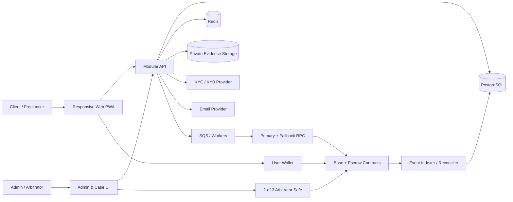

# EscrowAfrica Product and Architecture Blueprint

Status: proposed commercial-launch blueprint  
Prepared: 20 August 2026  
Scope: Nigeria-first, international clients, expansion-ready for Ghana and Kenya

> This is product and technical architecture, not legal advice. Before accepting mainnet funds, Nigerian counsel and the relevant regulators must confirm EscrowAfrica's licensing, AML/CFT, consumer-protection, tax, and cross-border-payment obligations. A non-custodial design reduces custody risk but does not automatically remove VASP or other regulatory obligations.

## Executive recommendation

Launch EscrowAfrica as a bilateral, non-custodial freelance escrow service—not a full freelance marketplace. Parties bring an existing work relationship, agree to up to ten milestones, and fund the full agreement in native USDC on Base. Deliverables and evidence remain private off-chain; only hashes and settlement state go on-chain. A client can approve a milestone immediately, or it releases after a disclosed review window if no dispute is opened. A dispute freezes unreleased funds and is decided by an independent 2-of-3 Safe multisig under published arbitration rules.

The first commercial release should have:

- One chain: Base.
- One token: Circle-issued native USDC, explicitly allowlisted by contract address.
- One contract model: fully funded, fixed-price, sequential milestones.
- One dispute model: human review and a 2-of-3 arbitrator Safe.
- One application: responsive web/PWA; no native mobile app.
- No custody of user keys, no fiat balance, no job marketplace, no custom token, no DAO jury, and no multi-chain bridging.

This gives customers the essential promise—provable funding and rule-bound settlement—while keeping smart-contract, regulatory, and operational scope controllable.

## Product principles

1. Funds safety before feature breadth.
2. Explain the workflow in ordinary payment language; blockchain terminology is secondary.
3. Minimize what is on-chain and what EscrowAfrica can control.
4. Never claim that a payment is final until the configured chain confirmation threshold is met.
5. No administrative ability to redirect funds outside published settlement paths.
6. Make deadlines, fees, review windows, dispute rules, and stablecoin risks visible before acceptance.
7. Design compliance and country expansion as configurable policy layers, not scattered conditionals.

## 1. Product requirements document

### 1.1 Product vision

Make cross-border freelance work with African professionals feel as safe and predictable as working through a trusted local intermediary, without requiring either party to surrender control of funds to EscrowAfrica.

### 1.2 Problem statement

Freelancers face non-payment, late payment, high cross-border fees, currency instability, and weak recourse. Clients face delivery and quality risk, difficulty verifying counterparties, and uncertainty about dispute handling. Informal wallet-to-wallet payments solve transfer but not trust.

### 1.3 Value proposition

- Freelancer: see that the full contract is funded before starting and receive released funds directly to a wallet.
- Client: funds cannot be released outside agreed approval, timeout, mutual cancellation, or arbitration paths.
- Business/agency: standardized milestones, auditable transactions, and contract records.
- Platform: earns a transparent fee only when value is released, without operating a pooled customer wallet.

### 1.4 Goals for the first 12 months after launch

- Prove demand for invite-based, bilateral USDC escrow between Nigerian freelancers and international clients.
- Establish a safe operational and regulatory path for Nigeria.
- Make at least 99.5% of confirmed release transactions reconcile correctly without manual intervention.
- Keep confirmed platform-caused loss at zero.
- Resolve 90% of accepted dispute cases within seven calendar days of complete evidence.
- Achieve at least 60% repeat use among customers who complete a first contract.
- Validate pricing, initially modeled at 1.5% of released value, before fixing the commercial rate.

### 1.5 Non-goals for MVP

- Job listings, bidding, matching, time tracking, or a public talent marketplace.
- Fiat custody, stored balances, cards, bank payouts, swaps, or exchange services.
- Support for volatile assets, custom platform tokens, yield, lending, staking, or investment returns.
- Multi-chain contracts, bridges, DAO/community juries, or algorithmic dispute decisions.
- Native iOS/Android applications.
- Legal adjudication of highly subjective or unlawful work; prohibited-use policy applies.

### 1.6 Business model

The default model is a disclosed platform fee deducted pro rata from freelancer releases. The fee rate and treasury address are snapshotted in each escrow at creation, so later configuration changes cannot alter existing agreements. Refunds should not incur the platform fee. Dispute fees, if introduced later, must be separately disclosed and should not give arbitrators an incentive to create or prolong disputes.

Before launch, finance and counsel must decide who legally pays the fee, invoicing/VAT treatment, stablecoin accounting, and whether the product is principal, agent, technology provider, VASP, or another regulated category.

### 1.7 Success metrics

| Area | Primary measures |
|---|---|
| Acquisition | Verified registrations, accepted invites, funded first contracts |
| Activation | Draft-to-acceptance conversion, acceptance-to-funding conversion, median time to fund |
| Trust | Funded GMV, completed GMV, dispute rate, timeout-release rate, support contacts per contract |
| Reliability | Deposit/release reconciliation rate, stuck transaction count, indexer lag, notification success |
| Retention | 30/90-day repeat contract rate, client-freelancer pair reuse |
| Economics | Released GMV, realized fee revenue, compliance cost, arbitration cost, contribution margin |
| Safety | Confirmed loss, account takeover, sanctions alerts, unresolved reconciliation exceptions |

Metrics must segment by country, client type, wallet type, contract size, and acquisition channel without exposing protected personal data.

## 2. User personas

### Persona A: Ada, Nigerian independent freelancer

- Works in design/software and invoices overseas clients for USD 300–5,000 projects.
- Needs proof of funding, predictable release, low fees, mobile usability, and clear withdrawal guidance.
- May understand USDC but not gas, networks, approvals, or transaction finality.
- Primary fears: wrong network, wallet compromise, client silence, unfair arbitration, and inability to convert proceeds.

### Persona B: Michael, international startup client

- Hires remotely and wants delivery protection, documentation, and a simple accounting trail.
- Comfortable with SaaS, possibly unfamiliar with self-custody.
- Primary fears: paying the wrong address, low-quality work, unclear refund rules, compliance exposure, and price volatility.

### Persona C: Tola, African agency owner

- Manages multiple client projects and contractors under one business identity.
- Needs organization records, reusable counterparties, role separation, and downloadable statements.
- In MVP, receives a basic business profile and manual KYB; multi-seat approval workflows wait until later.

### Persona D: Amara, dispute resolver

- Reviews contracts, submissions, communication records, and evidence under a published policy.
- Needs conflict checks, immutable case history, masked PII, decision templates, and Safe transaction signing.
- Must never possess a unilateral fund-release key.

### Persona E: Chidi, compliance/platform administrator

- Monitors KYC, risk alerts, support issues, transaction reconciliation, prohibited use, and operational health.
- Needs least-privilege tools, reason-coded actions, dual control for sensitive changes, and tamper-evident audit logs.
- Administration and arbitration are separate roles.

## 3. User journeys

### 3.1 Registration and readiness

1. User signs in with verified email and creates an individual or organization profile.
2. User accepts the current terms, privacy notice, prohibited-use policy, and arbitration rules.
3. User links a wallet by signing a one-time domain-bound message; linking never asks for a seed phrase.
4. Before funding or receiving value, the user completes the required KYC/KYB tier.
5. The platform screens identity and wallet risk and shows a clear Ready / Action required state.

### 3.2 Create, accept, and fund an agreement

1. Client creates a private agreement with title, scope, deliverables, milestones, amounts, deadlines, review window, included revision expectations, and invitee.
2. System validates that milestone totals equal the agreement total and presents fees and settlement rules.
3. Freelancer reviews the plain-language agreement and signs an EIP-712 acceptance of its canonical hash.
4. Client approves the exact USDC amount and funds the new escrow. The UI shows Pending until the configured confirmation threshold is reached.
5. Both parties receive confirmation and the freelancer starts only after status is Funded.

### 3.3 Submit and release a milestone

1. Freelancer uploads private deliverables or links, passes malware checks, and submits the milestone.
2. The application records an immutable submission version and puts only its digest on-chain.
3. Client receives reminders and can approve, collaborate on a resubmission, or open a dispute before the review deadline.
4. Approval immediately releases that milestone less the disclosed fee.
5. If the review window expires with no dispute, a permissionless contract function releases the milestone; an EscrowAfrica automation normally calls it, but correctness does not depend on that automation.

### 3.4 Dispute

1. Either party opens a dispute while funds remain unreleased, supplies a reason, and receives an evidence deadline.
2. The contract freezes all unreleased funds for the simple MVP model; already released milestones remain final.
3. Compliance checks eligibility, conflicts, and prohibited content, then assigns the case to the arbitration panel.
4. Parties submit private evidence. Every version is hashed and audit logged.
5. Arbitrators choose release, refund, or split and document reasons under the policy.
6. A 2-of-3 Safe executes the on-chain award. The application reconciles the event and notifies both parties.
7. MVP has no internal appeal. Terms must state available external legal rights and jurisdiction.

### 3.5 Mutual cancellation

1. Either party proposes cancellation before final completion.
2. The other accepts on-chain.
3. Unreleased funds return to the client; completed releases remain final. If they do not agree, the dispute path applies.

### 3.6 Reputation

1. After completion or resolved termination, each party can leave one rating tied to the funded agreement.
2. Ratings are hidden until both submit or a 14-day window ends.
3. Moderation can hide abusive text but cannot erase the underlying fact that a verified transaction occurred.

## 4. Functional requirements

Priority uses Must (launch blocking), Should (near-term), and Later.

| ID | Requirement | Priority |
|---|---|---|
| AUTH-01 | Email registration/login, verified email, secure session management, recovery, and terms-version acceptance | Must |
| AUTH-02 | Wallet linking through nonce-based, domain-bound signature; multiple users cannot silently claim the same active wallet | Must |
| AUTH-03 | MFA for every admin/arbitrator and step-up authentication for sensitive user actions | Must |
| PROF-01 | Individual freelancer/client profile, country, skills, bio, avatar, and verification badge | Must |
| PROF-02 | Basic organization profile and manual KYB status | Must |
| PROF-03 | Team members, roles, spending approval, and agency subaccounts | Later |
| ESC-01 | Private draft, invite, canonical terms hash, acceptance signature, expiry, and audit trail | Must |
| ESC-02 | One to ten fixed USDC milestones whose integer atomic-unit amounts exactly equal the total | Must |
| ESC-03 | Atomic creation/funding where feasible; otherwise an explicit resumable approval/deposit flow | Must |
| ESC-04 | Full agreement funding before work starts; partial top-ups are not allowed | Must |
| ESC-05 | Submission versions, private file/link storage, evidence digest, and review deadline | Must |
| ESC-06 | Client approval, permissionless timeout release, mutual cancellation, and final completion | Must |
| ESC-07 | Show transaction hash, confirmations, status, explorer link, failure reason, and replacement transaction | Must |
| DIS-01 | Dispute opening by either party, reason codes, evidence deadlines, and freeze of unreleased value | Must |
| DIS-02 | Private evidence access for parties and assigned arbitrators with immutable audit history | Must |
| DIS-03 | Multisig award supporting release, refund, or integer split without exceeding locked value | Must |
| DIS-04 | Conflict declaration, recusal, decision reason, SLA tracking, and case export | Must |
| REP-01 | Transaction-verified, bilateral 1–5 ratings with double-blind publication and moderation | Must |
| NOT-01 | In-app and email notifications for invite, funding, submission, deadlines, dispute, and settlement | Must |
| NOT-02 | SMS, WhatsApp, and push notifications | Later |
| ADM-01 | Search users/contracts/transactions/cases; view KYC state; suspend application access; manage support | Must |
| ADM-02 | Reconciliation queue, fee ledger, risk alerts, webhook health, and downloadable operational reports | Must |
| ADM-03 | Admin cannot directly transfer escrow funds; awards require the separate Safe signer process | Must |
| KYC-01 | Provider-agnostic KYC/KYB adapter, signed webhooks, retry/reconciliation, and country/risk tiers | Must |
| KYC-02 | Sanctions/PEP checks and wallet-risk screening before funding and before release | Must |
| API-01 | Versioned REST API, OpenAPI contract, idempotent commands, pagination, and consistent errors | Must |
| AUD-01 | Append-only security/audit events for authentication, terms, KYC, admin, dispute, and transaction actions | Must |

## 5. Non-functional requirements

### Security and correctness

- No EscrowAfrica server key can transfer customer escrow funds.
- All monetary values use token atomic units as integers; never binary floating point.
- On-chain invariant: deposits equal released-to-freelancer plus fees plus refunded-to-client plus remaining balance.
- At least one independent smart-contract audit, all critical/high findings closed, and a public bug-bounty process before unrestricted mainnet use.
- OWASP ASVS Level 2 baseline for the web/API; stronger controls for authentication and administration.
- Encrypt in transit with TLS 1.2+ and at rest with managed KMS keys; secrets never enter source control or CI logs.

### Reliability and recovery

- Target monthly availability: 99.9% for authenticated application and API, excluding blockchain-wide outages.
- API p95 under 500 ms for non-chain reads under normal load; chain confirmation time is reported separately.
- RPO no more than 15 minutes and RTO no more than four hours for off-chain services.
- Blockchain-derived state must be rebuildable by replaying events from deployment block.
- Chain indexer tolerates RPC failure, duplicate events, reordering, and reorganization.

### Privacy and compliance

- Collect only necessary personal data and maintain lawful-basis, retention, access, correction, deletion, objection, and breach workflows under the Nigeria Data Protection Act.
- KYC documents stay with the identity provider where possible; EscrowAfrica stores provider reference, result, reason category, timestamps, and audit evidence.
- No personal data, deliverable content, email, legal name, or KYC identifier goes on a public chain.
- Country launch is controlled by server-side policy configuration and legal approval, not only a UI flag.

### Usability and accessibility

- Responsive from 360 px width; core journeys usable on low-to-mid-range Android browsers and intermittent connections.
- WCAG 2.2 AA target, keyboard access, meaningful focus states, accessible transaction status, and no color-only signals.
- Plain-language confirmation screens show network, token, recipient role, amount, fee, consequence, and reversibility before signing.
- Save drafts and make multi-transaction funding resumable.

### Maintainability and observability

- Modular-monolith backend with explicit domain ownership; avoid microservices until scaling/team boundaries justify them.
- Structured logs, traces, metrics, correlation IDs, chain transaction IDs, and alert runbooks.
- Infrastructure as code, reproducible deployments, documented schema/contract migrations, and dependency update policy.

## 6. MVP scope

### Included

- Invite-only bilateral agreements; users already know their counterparty.
- Nigerian freelancers, supported international clients, and manually approved organizations.
- Responsive PWA with email login, profiles, external wallet connection, KYC/KYB status, and wallet-risk checks.
- Base mainnet and Circle-issued native USDC only; Base Sepolia in non-production.
- Fully pre-funded fixed-price agreements with one to ten sequential milestones.
- Private deliverable uploads/links, on-chain submission digests, client approval, timeout release, and mutual cancellation.
- One published arbitration policy, private evidence portal, and 2-of-3 Safe award execution.
- In-app/email notifications, verified bilateral ratings, transaction history, fee ledger, and explorer links.
- Admin/compliance dashboard, audit logs, monitoring, reconciliation, backups, and support tooling.
- Regulatory classification, terms, privacy, AML/CFT program, incident response, vendor contracts, and external contract audit as launch gates.

### Explicitly excluded

- Fiat on/off-ramp, bank/mobile-money withdrawals, custodial/embedded wallets, and gas abstraction.
- Open job marketplace, bidding, chat, hourly work, recurring contracts, and subscriptions.
- Multiple stablecoins, volatile tokens, multiple chains, bridges, swaps, and platform token.
- On-chain files, public evidence, DAO juries, automated quality decisions, and appeals.
- Native mobile applications and full organization/team permissions.

### MVP usability compromise

External wallets keep custody and integration scope simple but require Base ETH for gas. The pilot must include network education, transaction simulation, gas estimation, and support. Managed smart accounts and sponsored gas should be the first post-MVP usability experiment; they should enter MVP only if user testing shows external-wallet friction makes the product non-viable and the selected provider passes security/compliance review.

## 7. Post-MVP scope

### Next: improve activation and commercial operations

- Passkey/embedded non-custodial smart accounts, account recovery, and sponsored gas.
- Licensed fiat on/off-ramp integrations, NGN/GHS/KES payout partners, and recipient bank/mobile-money flows.
- Organization workspaces, team roles, client purchase-order references, invoices, and accounting exports.
- Parallel milestones, milestone-by-milestone funding, amendments signed by both parties, and reusable templates.
- SMS/WhatsApp notifications and richer support tooling.
- Independent arbitration partners, appeal tier, and country-specific policy packs.

### Later: expand product and geography

- Ghana and Kenya after local VASP, payment, AML, privacy, tax, and consumer-protection launch gates.
- Additional stablecoins or chains only after liquidity, off-ramp, security, issuer, and support analysis.
- Curated talent discovery, proposals, and messaging; not necessarily an open marketplace.
- Advanced agency features, subcontractor allocation, batch agreements, and API access for businesses.
- Portable reputation/credentials, fraud graph, risk-adjusted contract limits, and optional insurance partnerships.
- Native mobile apps if PWA data demonstrates a clear retention or notification benefit.

### Features to avoid until there is a compelling regulated use case

- EscrowAfrica token, staking/yield, speculative incentives, bridges controlled by the platform, anonymous arbitration, and fully autonomous dispute decisions.

## 8. Recommended technology stack

| Layer | Recommendation | Rationale |
|---|---|---|
| Web | Next.js, React, TypeScript, Tailwind CSS, accessible component primitives, PWA | Strong responsive ecosystem and shared types |
| Wallet | wagmi + viem; WalletConnect-compatible connector; SIWE-style nonce challenge | Mature EVM primitives without backend custody |
| API | Node.js LTS, TypeScript, NestJS with Fastify adapter, OpenAPI | Modular domains, validation, operational consistency |
| Background work | AWS SQS plus worker processes; EventBridge Scheduler | Durable retries for notifications, indexing, and timeout-release calls |
| Database | PostgreSQL on RDS Multi-AZ | Transactional source for product records and projections |
| Cache/rate limits | Redis/ElastiCache | Sessions, locks, throttling; never financial source of truth |
| Object storage | Private S3, KMS encryption, versioning, lifecycle rules, malware scan pipeline | Controlled evidence and deliverable storage |
| Smart contracts | Solidity, Foundry, OpenZeppelin Contracts, Slither, Echidna/Foundry invariants | EVM security tooling and testing depth |
| Chain | Base mainnet / Base Sepolia; native USDC only | EVM compatibility, low-cost L2, native issuer-supported USDC |
| Arbitration | Safe 2-of-3 smart account controlled by independent signers | Auditable multisig without custom threshold cryptography |
| Identity | Managed OIDC authentication provider; separate KYC/KYB provider behind an internal adapter | Avoid building identity proofing; retain vendor portability |
| Chain access | Two independent Base RPC providers, one primary and one failover | Reduces provider outage and data-integrity dependence |
| Observability | OpenTelemetry, CloudWatch, Sentry-compatible error tracking, managed uptime checks | Cross-service and chain transaction visibility |
| Infrastructure | AWS ECS Fargate, ALB, CloudFront, WAF, Route 53, Terraform | Lower operational burden than Kubernetes for MVP |
| CI/CD | GitHub Actions with AWS OIDC, protected environments, signed artifacts, staged promotion | No long-lived cloud credentials in CI |

Do not pin framework versions in this architecture document. Pin reviewed versions in lockfiles and deployment manifests, and update them through automated tests and security review.

## 9. System architecture

### Architectural boundaries

- On-chain source of truth: escrow balances, parties' wallet addresses, token, milestone amounts/status, deadlines, submission digests, fees, disputes, and awards.
- Off-chain source of truth: identity, profiles, human-readable terms, signed agreement envelope, files, evidence, case notes, notifications, KYC/risk decisions, and ratings.
- Projection: PostgreSQL mirrors chain events for fast UI/search but never overrides a confirmed contract state.
- User transaction path: API validates policy and prepares data/calldata; the user's wallet signs and submits value-moving actions. The API does not sign as the user.
- Automation path: a narrowly permissioned relayer may call permissionless timeout-release functions and pay gas; it cannot choose recipients or amounts.

### Backend modules

Keep one deployable backend initially, with modules for Identity, Profiles, Organizations, Agreements, Submissions, Disputes, Reputation, Compliance/Risk, Blockchain, Notifications, Ledger/Reconciliation, and Administration. Use domain events internally and SQS for slow or retryable work. Split services only when load, isolation, or team ownership creates a measured need.

## 10. Database architecture

### Core relational model

| Table/group | Essential fields and notes |
|---|---|
| users | ID, email identity reference, country, status, risk tier, timestamps |
| profiles | User ID, role, display data, skills, avatar key, moderation state |
| organizations / memberships | Legal/display data, KYB state; MVP membership may be owner-only |
| wallets | Chain ID + canonical address, verified timestamp, verification nonce record, risk state |
| terms_acceptances | User, terms type/version/hash, timestamp, IP/device evidence as legally approved |
| agreements | Parties, canonical terms JSON/hash, off-chain status, contract address/version, token, total atomic units, review window |
| milestones | Agreement, sequence, amount atomic units, due date, projected on-chain status, release/refund amounts |
| submissions | Immutable versions, milestone, submitter, object/link references, content digest, on-chain tx |
| disputes / dispute_parties | Case state, reason, deadlines, assigned panel, conflict checks, outcome, award tx |
| evidence_items | Private object key, digest, submitter, visibility, malware state, retention class |
| ratings | Agreement, rater/ratee, score, text, reveal date, moderation state, unique per side |
| kyc_checks / wallet_screenings | Provider reference, policy version, result, reason category, timestamps; no raw documents |
| chain_transactions | Chain, hash, sender, nonce, intent, lifecycle, confirmations, replacement hash, error |
| chain_events | Chain, block hash/number, tx/log index, contract/version, decoded payload, canonical flag; unique event identity |
| fee_ledger | Agreement/milestone, gross, fee, net, token, tx/event reference; append-only |
| notifications | Template/version, channel, recipient, schedule, delivery state, provider reference |
| webhook_receipts | Provider, event ID, signature state, payload digest, processing state; unique for idempotency |
| audit_log | Actor, action, target, reason, before/after digests, request ID, timestamp; append-only and exported to immutable storage |

### Data rules

- Use UUIDv7 or equivalent sortable opaque IDs off-chain.
- Store token values as `NUMERIC(78,0)` or validated decimal strings representing integers.
- Every address is keyed by chain ID and 20-byte canonical value; checksum formatting is presentation only.
- Use database constraints for milestone order, unique wallet claims, ratings, webhook IDs, and chain-event identity.
- Soft deletion is not a privacy strategy. Define field-level deletion/anonymization and legally required retention classes.
- Partition high-volume audit, notification, and chain-event tables when measurements justify it.
- Encrypt especially sensitive fields at the application layer with envelope keys where database administrators should not see plaintext.

### Chain synchronization

Ingest logs only from known factory/escrow versions. Record unconfirmed events, promote them after a configurable threshold, and mark orphaned events non-canonical after a reorg. A reconciliation job compares on-chain balances and milestone totals with projections and the fee ledger. Any mismatch stops affected automation and creates an incident, never an automatic database “correction.”

## 11. Smart-contract architecture

### Contract set

1. `EscrowFactoryV1`: allowlists the exact token and implementation, validates parameters, creates deterministic versioned escrows, and emits registry events.
2. `MilestoneEscrowV1`: a non-upgradeable implementation instantiated as EIP-1167 clones. Each instance belongs to one accepted agreement and holds only that agreement's USDC.
3. Existing Safe deployment: the arbitrator address authorized to resolve disputes; no custom multisig contract.
4. Treasury Safe: receives platform fees and is operationally/signature-separated from the arbitrator Safe.

Deploy new immutable versions for changes. Do not put customer funds behind a proxy upgrade key. The factory can pause creation of new escrows, but no global administrator should be able to pause legitimate withdrawals from already funded agreements.

### Escrow state

An instance stores client, freelancer, token, total funded amount, terms hash, fee basis points, treasury, arbitrator Safe, review window, current state, and milestones. Each milestone stores amount, deadline, status, submission digest/time, and settled allocation.

Recommended agreement states are `AWAITING_FUNDING`, `ACTIVE`, `DISPUTED`, `COMPLETED`, `CANCELLED`, and `RESOLVED`. Recommended milestone states are `PENDING`, `SUBMITTED`, `RELEASED`, `REFUNDED`, and `RESOLVED`.

### Core transitions

- `fund`: client transfers the exact full total before an expiry; fee-on-transfer and unexpected tokens are not supported.
- `submitMilestone`: freelancer records a non-zero digest for the next open milestone and starts/restarts its review clock.
- `approveMilestone`: client releases gross amount, splitting snapshotted fee and freelancer net.
- `releaseAfterDeadline`: anyone can execute the exact same split after review expiry if no dispute exists.
- `openDispute`: either party freezes all unreleased funds and emits the case reference digest.
- `resolveDispute`: arbitrator Safe allocates locked amounts between client, freelancer, and disclosed fee according to the award; totals must exactly match locked value.
- `requestCancellation` / `acceptCancellation`: mutual flow refunds all unreleased value without a platform fee.

### Critical invariants

- Only the client can fund/approve; only the freelancer can submit; either can dispute; only the snapshotted Safe can resolve.
- Sum of milestone amounts equals the funded total.
- No milestone or agreement can be settled twice.
- Total outbound value never exceeds actual funded value.
- Fee never exceeds the immutable contract cap and is charged only on value awarded/released to the freelancer.
- A dispute prevents approval and timeout release until resolution.
- Unknown tokens, direct native-asset deposits, and arbitrary external calls are rejected or safely unrecoverable under a documented policy.
- State changes precede external token transfers; use `SafeERC20` and reentrancy protection where appropriate.

### Operational considerations

- Verify source and metadata on the explorer and publish addresses/version hashes.
- Deployment and factory configuration occur through a deployment Safe with documented signer ceremony.
- Monitor USDC issuer pause/blacklist events and disclose that issuer controls can freeze an address, including an escrow.
- Do not store plaintext terms, names, links, or evidence on-chain. A digest proves integrity, not truth or satisfactory quality.
- “Automatic” release means a permissionless time-based function. A bot improves convenience but is not trusted for payout logic.

## 12. API architecture

### Style and contracts

- REST JSON under `/v1`, documented with OpenAPI; generated typed clients for the web application.
- OAuth/OIDC session for application identity plus a linked-wallet proof for wallet ownership.
- `Idempotency-Key` required for create/accept/submit/dispute commands and all provider webhooks.
- RFC 7807-style error bodies, request/correlation ID, cursor pagination, UTC timestamps, and explicit chain/token identifiers.
- Optimistic concurrency with record versions or `If-Match` on mutable drafts and case records.

### Representative endpoints

| Domain | Endpoints |
|---|---|
| Auth/wallet | `POST /auth/wallet/challenge`, `POST /auth/wallet/verify`, `DELETE /wallets/{id}` |
| Profile | `GET/PATCH /me`, `GET /profiles/{id}`, `POST /organizations` |
| Compliance | `POST /kyc/sessions`, `GET /compliance/readiness`, provider webhook endpoints |
| Agreement | `POST /agreements`, `PATCH /agreements/{id}`, `POST /agreements/{id}/invite`, `POST /agreements/{id}/accept` |
| Funding | `POST /agreements/{id}/funding-intent`, `GET /transactions/{hash}` |
| Work | `POST /milestones/{id}/uploads`, `POST /milestones/{id}/submissions`, `POST /milestones/{id}/approval-intent` |
| Dispute | `POST /agreements/{id}/disputes`, `POST /disputes/{id}/evidence`, case-management endpoints |
| Reputation | `POST /agreements/{id}/ratings`, `GET /profiles/{id}/ratings` |
| Admin | users, risk cases, reconciliation exceptions, disputes, audit, configuration reads |

An `*-intent` endpoint returns reviewed calldata/typed data and a human-readable simulation. The wallet submits the transaction. The API watches and reconciles it; it must not mark the business action confirmed merely because a transaction hash was received.

### Webhooks and events

KYC, email, and chain-provider webhooks terminate at dedicated endpoints that verify signatures, timestamp windows, and unique event IDs before queueing. Internal events such as `AgreementFunded`, `MilestoneSubmitted`, and `DisputeResolved` drive notifications and projections through an outbox pattern so database commits and queued work do not diverge.

## 13. Security architecture

### Main threats and controls

| Threat | Principal controls |
|---|---|
| Contract bug drains/locks funds | Minimal immutable contracts, allowlisted token, formal invariants, fuzzing, independent audit, capped pilot, versioned deployment |
| Admin/arbitrator compromise | Separate roles and Safes, 2-of-3 independent hardware-backed signers, MFA, step-up auth, audit alerts, signer rotation procedure |
| Account takeover / wallet substitution | Managed auth controls, nonce/domain/expiry signature, notification on wallet changes, cooldown and re-verification before financial use |
| Phishing/wrong transaction | Simulation, decoded confirmation screen, exact chain/token/address checks, CSP, verified domain education, never request seed phrases |
| KYC or evidence leakage | Data minimization, provider-hosted KYC, private buckets, KMS, short-lived URLs, ABAC, malware scanning, access logging, retention deletion |
| Webhook spoof/replay | Provider signature verification, timestamp tolerance, unique event ID, payload digest, IP restrictions where supported |
| Blockchain reorg/RPC corruption | Confirmation threshold, two RPC providers, block-hash tracking, reorg rollback, independent balance reconciliation |
| Sybil/reputation manipulation | Ratings only after funded settlement, one rating per side, KYC/risk graph, moderation, no transferable reputation token |
| Sanctions/illicit funds | Identity and wallet screening, ongoing/triggered rescreening, limits, risk case management, documented escalation and reporting |
| Malicious uploads | Type/size allowlist, quarantine, antivirus/content scanning, no active rendering, sandboxed previews, expiring downloads |
| Insider misuse | Least privilege, just-in-time production access, approval workflows, immutable audit export, quarterly access review |

### Key management

- Customer keys remain in customer wallets. EscrowAfrica never receives seed phrases or exports private keys.
- Treasury, arbitrator, and deployment Safes use different signers and policies.
- Automation keys can only call permissionless methods, maintain small gas balances, live in managed KMS/HSM where supported, and are rotated.
- Cloud secrets live in Secrets Manager; CI uses short-lived OIDC credentials.

### Secure development lifecycle

- Threat model each money-state change and vendor integration.
- Mandatory review for contract, authentication, authorization, and ledger changes.
- SAST, dependency/license scanning, secret scanning, IaC scanning, container scanning, and DAST in CI/staging.
- External penetration test for web/API/admin plus independent contract audit before public mainnet.
- Responsible disclosure and bug bounty with severity-based response targets.
- Incident plan covers contract flaw, Safe signer compromise, USDC freeze, chain/RPC outage, data breach, KYC-provider outage, and bad arbitration transaction.

### Regulatory and legal launch controls

The SEC's digital-asset rules have broad VASP applicability, and its ARIP/FinPort process exists for novel digital-asset providers. Obtain written Nigerian legal classification and engage SEC/other authorities before production. Determine AML reporting responsibilities, applicable contract/arbitration law, consumer complaint handling, cross-border restrictions, tax/VAT, data-controller registration/assessment, and whether a licensed Nigerian partner is required.

Do not launch Ghana or Kenya merely by enabling a country dropdown. Both have current VASP regimes; each country requires an activities analysis, regulator/licence or partner determination, local AML/privacy controls, product disclosures, and operational readiness.

## 14. Deployment architecture

### Environments

- Local: local EVM/anvil, synthetic identities, no production credentials.
- CI: ephemeral tests and contract fuzzing.
- Development: Base Sepolia, isolated AWS account/database.
- Staging: production-shaped, Base Sepolia, synthetic KYC, release candidate.
- Production: Base mainnet, separate AWS account, strict access, real provider tenants.

Never reuse wallets, KMS keys, databases, buckets, webhooks, or credentials across environments.

### AWS topology

CloudFront and WAF front the PWA and ALB. Stateless API and worker tasks run in private subnets on ECS Fargate. RDS PostgreSQL Multi-AZ and ElastiCache are private. S3 uses block-public-access, versioning, KMS, and restricted access points. NAT egress is allowlisted where practical. Security logs flow to a separate, append-protected account/bucket.

### Release process

1. Pull request runs lint, types, unit/integration, contract, security, migration, and build checks.
2. Signed image/artifact is promoted—not rebuilt—through development and staging.
3. Production deploy requires protected-environment approval and generates release evidence.
4. Backend uses rolling or blue/green deployment and expand/contract database migrations.
5. Smart-contract deployment is a separate Safe-approved ceremony: reproduce bytecode, simulate, deploy, verify, configure allowlists, run smoke transactions, and publish addresses.

### Resilience and disaster recovery

- Point-in-time database recovery, encrypted backups, quarterly restore tests, and documented RPO/RTO.
- Object versioning and appropriate cross-region recovery for evidence, subject to residency/legal review.
- Multi-AZ application/data services and two independent RPC providers.
- If the application is unavailable, users' funded contracts remain on-chain; publish a verified emergency read/interaction guide after security review.
- Rebuild projections from deployment blocks and reconcile every escrow balance before re-enabling automation.

## 15. Testing strategy

### Test pyramid

- Unit: domain policies, permissions, fee/amount calculations, state mapping, notification rules, canonical hashing.
- Contract unit: every allowed/forbidden state transition, role check, deadline boundary, rounding case, and token failure.
- Property/invariant: conservation of funds, no double settlement, fee cap, authorization, dispute freeze, and random action sequences.
- Integration: PostgreSQL/outbox/SQS, KYC/email webhooks, S3 permissions, RPC failure/retry, Safe transaction proposal, and chain event ingestion.
- Fork: native Base USDC behavior and deployed Safe interaction against a pinned Base fork.
- End-to-end: registration through funding, submission, approval/timeout, dispute award, rating, and reconciliation on Base Sepolia.
- Security: authorization matrix, session/cookie/CSRF/XSS/SSRF/upload abuse, rate limiting, dependency/IaC/container scans, DAST, penetration test.
- Performance: peak reads, transaction tracking, webhook bursts, indexer catch-up, notification queue, and large evidence uploads.
- Resilience: RPC/provider outage, delayed/reordered/duplicate webhooks, reorg simulation, worker crash, database failover, email/KYC outage, and restore drill.
- UX/accessibility: Android/iOS browsers, slow/intermittent networks, wallet rejection/network mismatch, screen readers, keyboard, contrast, and comprehension tests.

### Required lifecycle scenarios

1. Accepted agreement expires unfunded.
2. Exact funding succeeds; short/extra/wrong-token/wrong-chain attempts fail safely.
3. Each milestone approves and fee arithmetic reconciles exactly.
4. Submission at a timestamp boundary cannot release early.
5. Dispute and timeout transactions race; only one valid state transition wins.
6. Mutual cancellation cannot refund released value.
7. Split award totals exactly locked value, including smallest atomic-unit rounding.
8. Duplicate/replaced/reorged transactions converge to canonical state.
9. USDC transfer failure cannot leave state marked settled.
10. Compromised ordinary admin account cannot move funds or sign an award.

### Release gates

- Zero open critical/high security findings; medium findings have owners and explicit risk acceptance.
- 100% pass for money-state tests and contract invariants.
- Smart-contract audit fixes independently retested.
- Database restore and chain replay demonstrated.
- Compliance, incident response, customer support, arbitration runbooks, and Safe signer drill completed.
- Capped invite pilot precedes raising contract/GMV limits.

## 16. Development roadmap

Assumes a focused team: product/architecture lead, product designer/researcher, two frontend/full-stack engineers, two backend/platform engineers, one Solidity/security engineer, one QA/SDET, fractional DevOps/SRE, and dedicated compliance/legal support. External auditors are additional.

### Phase 0 — Commercial and regulatory discovery (weeks 1–4)

- Interview 15–20 Nigerian freelancers and 10–15 international clients.
- Test contract sizes, review windows, fee willingness, wallet literacy, and off-ramp behavior.
- Obtain legal classification memo; engage SEC FinPort/ARIP or identify licensed-partner path.
- Select KYC, wallet-risk, email, cloud, RPC, audit, and arbitration partners.
- Draft prohibited-use, arbitration, privacy, complaints, AML, and incident policies.

Exit: written launch path, validated problem, explicit supported countries/users, vendor risk sign-off, and MVP economics.

### Phase 1 — Product and protocol design (weeks 3–6)

- Prototype mobile-first registration, agreement, funding, submission, approval, and dispute journeys.
- Usability-test wallet/network/gas comprehension.
- Freeze canonical agreement schema, state machines, invariants, threat model, and admin permissions.
- Define analytics, support SLAs, contract limits, and pilot controls.

Exit: tested prototype and signed product/protocol specification.

### Phase 2 — Foundation and contract implementation (weeks 6–11)

- Establish monorepo, CI/CD, IaC, environment isolation, auth, profiles, database, audit, and observability.
- Implement factory/escrow contracts, unit/fuzz/invariant/static tests, deployment scripts, and Base Sepolia explorer verification.
- Build chain indexer/reconciler and transaction-status UX.

Exit: full happy-path escrow lifecycle on testnet with exact ledger reconciliation.

### Phase 3 — Feature-complete private alpha (weeks 10–16)

- Complete milestones, private uploads, notifications, KYC/risk adapters, disputes, Safe workflow, ratings, admin, and support tools.
- Add accessibility, responsive states, failure recovery, analytics, and provider reconciliation.
- Run internal tabletop disputes and incident scenarios.

Exit: end-to-end alpha using synthetic identities and funds; operational runbooks drafted.

### Phase 4 — Hardening and external assurance (weeks 16–20)

- Contract audit, web/API penetration test, privacy/security assessment, load/resilience tests, backup restore, and disaster drill.
- Fix and retest findings; finalize terms, disclosures, fee policy, limits, signer ceremony, and customer support training.
- Deploy immutable V1 through Safe, verify bytecode, and run small-value production smoke tests if legally authorized.

Exit: all release gates passed and formal go/no-go approval.

### Phase 5 — Capped invite pilot (weeks 21–24)

- Onboard 20–50 vetted client/freelancer pairs.
- Enforce per-contract, per-user, daily, and total platform exposure limits.
- Review every exception, dispute, KYC alert, timeout release, and support interaction.
- Measure conversion, repeat use, dispute economics, wallet friction, and off-ramp pain.

Exit: zero unexplained money mismatches/loss, acceptable support and dispute load, and evidence for limit increases or product changes.

### Phase 6 — Controlled commercial launch

- Raise limits gradually by risk tier.
- Publish verified contract addresses, audit summary, status page, security contact, dispute policy, and fee schedule.
- Prioritize passkey/gas sponsorship and licensed local payout integrations based on pilot evidence.
- Start Ghana/Kenya regulatory discovery independently; do not reuse Nigerian approval assumptions.

## Decisions required before build starts

1. Legal/regulatory operating model: own authorization/sandbox, licensed partner, or narrower technology-provider model.
2. Contracting entity, governing law, arbitration seat/rules, and enforceability across client countries.
3. Who pays the platform fee, initial basis points, tax treatment, and pilot limits.
4. Exact review-window default and allowed per-contract range; recommended default is seven calendar days.
5. Arbitrator governance: signer identities, independence, conflicts, compensation, SLA, replacement, and deadlock plan.
6. Supported client countries and prohibited industries at launch.
7. KYC/KYB and blockchain-analytics provider selection after coverage, data-residency, accuracy, SLA, and exit review.
8. Whether external-wallet friction is acceptable for MVP or a reviewed smart-account provider must be brought forward.

## Current primary-source notes

- Nigeria SEC's [Rules on Issuance, Offering Platforms and Custody of Digital Assets](https://sec.gov.ng/wp-content/uploads/2022/05/Rules-on-Issuance-Offering-and-Custody-of-Digital-Assets.pdf) include broad VASP applicability; SEC also operates [FinPort RI/ARIP programs](https://www.sec.gov.ng/fintech-and-innovation-hub-finport/finport-programs-ri-and-arip/). Regulatory interpretation for this exact escrow model must come from counsel/regulators.
- The Central Bank of Nigeria has published [guidelines for VASP bank accounts](https://www.cbn.gov.ng/Out/2024/FPRD/GUIDELINES%20ON%20OPERATIONS%20OF%20BANK%20ACCOUNTS%20FOR%20VIRTUAL%20Asset%20Providers.pdf), reinforcing that banking, AML, and eligible-entity arrangements need an explicit plan.
- The [Nigeria Data Protection Act 2023](https://ndpc.gov.ng/wp-content/uploads/2024/03/Nigeria_Data_Protection_Act_2023.pdf) governs personal-data processing; the NDPC summarizes controller/processor obligations and data-subject protections in its [official FAQ](https://www.ndpc.gov.ng/faqs/).
- Circle lists native USDC contract addresses for both [Base mainnet and Base Sepolia](https://developers.circle.com/stablecoins/usdc-contract-addresses). The application must pin and independently verify the selected address.
- Base documents the L2 execution plus L1 security components of [network fees](https://docs.base.org/base-chain/network-information/network-fees); the UI must estimate and disclose gas rather than promise a fixed price.
- Kenya's [Virtual Asset Service Providers Act 2025](https://new.kenyalaw.org/akn/ke/act/2025/20/eng%402025-11-04) establishes licensing and operational requirements. The Bank of Ghana states that its [Virtual Asset Service Providers Act 2025](https://www.bog.gov.gh/virtual-assets/) establishes registration, licensing, and supervision in Ghana.
